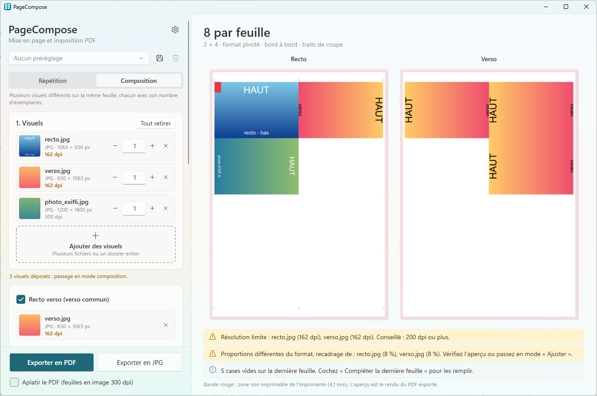
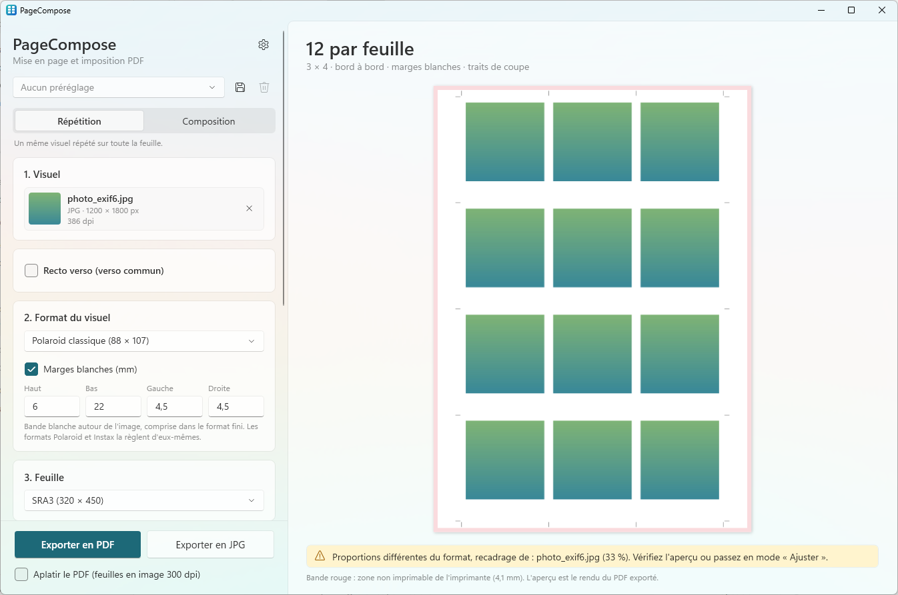

<p align="center">
  
</p>

<h1 align="center">PageCompose</h1>

<p align="center">
  Mettez en page cartes de visite, tirages photo et flyers sur une feuille, prêts à imprimer, en quelques clics.
</p>

<p align="center">
  <a href="README.md">English</a> · <b>Français</b>
</p>

<p align="center">
  
</p>

---

## Fonctionnalités

PageCompose transforme vos visuels (JPG, PNG ou PDF) en **PDF prêt à imprimer** : la feuille est remplie avec autant
d'exemplaires que possible, avec traits de coupe et fond perdu en option, prête à passer au massicot. Ses réglages
par défaut correspondent à la **FUJIFILM ApeosPro C810 for Photo** (feuilles SRA3, A3 et A4, marge non imprimable
de 4,1 mm), mais le PDF convient à toute imprimante qui imprime en taille réelle.

- **Deux modes** :
  - **Répétition** : un seul visuel répété sur toute la feuille (cartes de visite, flyers…). La quantité se saisit
    en visuels ou en feuilles ; la dernière feuille peut être complétée, ou ne porter que les visuels demandés.
  - **Composition** : plusieurs visuels différents sur la même feuille (les 8 photos d'une commande, par exemple),
    chacun avec son nombre d'exemplaires. La dernière feuille peut être complétée en répétant les visuels, ou
    garder ses cases vides.
- **Glisser-déposer** des fichiers ou un dossier entier n'importe où dans la fenêtre (ou cliquer pour choisir).
  Déposer plusieurs fichiers en mode répétition fait passer en composition.
- **Préréglages** : enregistrez sous un nom les réglages d'un travail habituel (mode, format et marges, feuille, coupe,
  quantité en visuels ou en feuilles, recto verso, export) et retrouvez-les en un clic. Les fichiers et le nombre
  d'exemplaires n'en font pas partie.
  **Paramètres → Préréglages** les exporte dans un fichier `.PageCompose` (tous dans `all-preset.PageCompose`, ou un
  seul sous son propre nom) et les importe, pour les copier sur un autre PC ou les sauvegarder. Un **double clic** sur un fichier `.PageCompose` (ou un glisser-déposer dans la fenêtre) les
  importe aussi ; un fichier d'un seul préréglage l'applique aussitôt. Ce fichier reste du JSON lisible avec le
  Bloc-notes.
- **PDF de plusieurs pages** : une liste sur la ligne du fichier choisit la page utilisée. Un PDF de deux pages en
  mode répétition (une carte de visite) donne d'un coup son recto et son verso.
- **Formats prédéfinis** : carte de visite 85 × 55, photos 9 × 13 / 10 × 15 / 13 × 18 / 15 × 20 / 20 × 30 (tailles
  de labo, en pouces : 10 × 15 = 4 × 6 po = 101,6 × 152,4 mm), carrés (dont un 10 × 10 avec une marge blanche de 5 mm), **cadres photo
  instantanée** (Polaroid classique, Instax Mini, Square et Wide, avec leur grosse bande en bas), carte postale A6,
  flyers DL et A5, A4, ou une taille libre.
- **Marges blanches** : une bande blanche à l'intérieur de chaque visuel, réglable côté par côté (haut, bas, gauche,
  droite). Les formats à cadre la règlent d'eux-mêmes ; elle s'applique au recto, et aussi au verso si vous cochez
  la case.
- **Feuilles** : SRA3 (320 × 450), A3 et A4 pour l'ApeosPro (marge non imprimable de 4,1 mm), **tirages labo**
  10 × 15, 20 × 30 et 30 × 45 (imprimés jusqu'au bord : quatre 10 × 15 sur un 20 × 30), ou une **feuille
  personnalisée** avec sa propre marge non imprimable.
- **Meilleur montage, automatiquement** : celui qui place le plus de visuels, en pivotant le format si besoin (un cadre
  Polaroid pivote alors avec sa photo, la grosse bande reste dessous). Chaque photo est tournée d'un quart de tour
  quand ses proportions le demandent ; un **clic droit** sur sa ligne la fait pivoter à la main (à droite, à gauche,
  180°), pour une photo prise de travers.
- **Coupe** : bord à bord (une seule coupe entre deux visuels), **traits de coupe** courts, **fond perdu**
  (2 mm par défaut) et, en option, un **espace entre les visuels** (5 mm par exemple) et des **lignes de coupe
  continues** sur tout le bloc.
- **Recto verso** : un verso commun à tous les visuels, placé pour retomber derrière son recto (retournement bord
  long ou bord court, rotation de 180° en option). L'aperçu montre **les deux faces côte à côte**.
- **Aperçu fidèle** : c'est le PDF exporté, rendu par Windows, avec la zone non imprimable en rouge.
  **Zoom** avec les loupes, Ctrl + molette ou un double clic (glisser pour se déplacer), affiché en % de la taille
  réelle ; le bouton « Ajuster » remet la feuille entière dans la vue.
- **Export en PDF ou en JPG** : le PDF garde les photos telles quelles (sans recompression) et les PDF de graphiste
  en vectoriel ; **« Aplatir le PDF »** fait de chaque face une seule image 300 dpi, sans rien à interpréter pour
  l'imprimante. **« Exporter en JPG »** écrit une image 300 dpi par face de feuille, pratique pour un labo photo.
  Une notification propose ensuite d'ouvrir le fichier (la première image pour un export JPG) ou de l'afficher dans
  son dossier.
- **Champs numériques** : les flèches haut et bas du clavier changent la valeur (Maj : de 10 en 10) ; « 0.1 » et
  « 0,1 » fonctionnent tous les deux.
- **Contrôles** : résolution effective de chaque visuel au format choisi (alerte sous 200 dpi), recadrage quand les
  proportions diffèrent du format.
- **Malin avec les fichiers** : les photos de téléphone sont remises à l'endroit (EXIF), un PDF de graphiste avec fond
  perdu est calé à 100 % sur sa zone de coupe, les JPEG sont intégrés sans recompression et stockés une seule fois.
  Un PDF non standard qui ne peut pas être importé (certains logiciels de facturation en produisent) est converti en
  image 300 dpi, avec un message pour le signaler.
- **Anglais et français** : l'application et l'installateur suivent la langue d'affichage de Windows ; la langue de
  l'application peut aussi être choisie dans les **Paramètres** (roue crantée).
- **Apparence Windows 11** (Fluent, Mica), **claire ou sombre** : elle suit le mode de Windows, ou le thème choisi dans les
  Paramètres.
- **Mises à jour en un clic** : l'application signale qu'une nouvelle version est publiée sur GitHub et l'installe
  pour vous (canal stable ou bêta, vérification au démarrage désactivable).

Exemples sur une feuille SRA3 :

| Format | Bord à bord | Avec fond perdu 2 mm |
|--------|:---:|:---:|
| Carte de visite 85 × 55 | 25 | 21 |
| Photo 10 × 15 | 8 | 4 |
| Photo 9 × 13 | 9 | 9 |
| Photo 13 × 18 | 4 | 4 |
| Polaroid classique 88 × 107 | 12 | 9 |
| Instax Mini 54 × 86 | 25 | 21 |
| Carte postale A6 | 8 | 6 |

<p align="center">
  
</p>

### Imprimer le PDF

Le PDF fait exactement la taille de la feuille et contient déjà la mise en page : imprimez-le **en taille réelle
(100 %)**, sans mise à l'échelle ni imposition de la part du pilote ou du serveur d'impression. Avec un FUJIFILM
GP Controller, déposez-le dans un hot folder réglé en taille réelle et sans imposition. Une feuille de tirage labo
part au labo à sa taille, sans marge.

## Installation

1. Téléchargez `PageCompose-Setup-x.y.z.exe` depuis la page [Releases](../../releases).
2. Lancez-le. L'installateur n'étant pas signé, Windows SmartScreen peut afficher « Windows a protégé votre
   ordinateur » : cliquez sur **Informations complémentaires → Exécuter quand même**.
3. Acceptez la demande d'administrateur (UAC).

L'installateur :

- copie l'application dans `C:\Program Files\PageCompose` et l'ajoute au menu Démarrer (raccourci bureau en option) ;
- associe les fichiers de préréglages `.PageCompose` à PageCompose (leur icône, et le double clic qui les importe) ;
- propose d'installer le **.NET 10 Desktop Runtime** de Microsoft s'il manque.

Les versions suivantes s'installent depuis l'application : quand l'une d'elles est disponible, une barre propose de
**Mettre à jour** (ou passez par **Paramètres → Mises à jour**). Le nouvel installateur est téléchargé depuis GitHub,
contrôlé avec le SHA-256 publié par GitHub, installé sans fenêtre d'assistant, puis PageCompose redémarre.

Pour désinstaller : **Paramètres → Applications → Applications installées → PageCompose**. Le désinstalleur retire
l'application, ses fichiers temporaires et l'association des fichiers `.PageCompose`, et demande s'il faut aussi supprimer vos réglages et préréglages (Non par
défaut, pour les retrouver après une réinstallation).

**Configuration requise :** Windows 10 2004 ou plus récent, x64 (conçu pour Windows 11).

## Développement

### Prérequis

Tout s'installe avec `winget` (intégré à Windows 11), depuis un terminal :

| Outil | Rôle | Installation |
|-------|------|--------------|
| **Git** | Récupérer le code | `winget install Git.Git` |
| **SDK .NET 10** | Compiler l'application (C# / WPF) et lancer les tests | `winget install Microsoft.DotNet.SDK.10` |
| **Inno Setup 6** | Construire l'installateur | `winget install JRSoftware.InnoSetup` |

N'importe quel éditeur (Visual Studio, VS Code, Rider) convient pour le code C#.

### Compiler

```powershell
.\scripts\build.ps1
```

Le script lance les tests, puis produit dans `dist\` :

| Fichier | Contenu |
|---------|---------|
| `app\` | l'application (`PageCompose.exe`…), dépendante du runtime .NET |
| `PageCompose-Setup-<version>.exe` | l'installateur |

Options : `-SkipTests`, `-NoInstaller`.

### Pendant le développement

```powershell
dotnet test tests\PageCompose.Core.Tests                            # tests unitaires
dotnet run --project src\PageCompose.App -- "C:\chemin\vers\photos" # lancer l'appli avec des fichiers ou un dossier
```

Définissez la variable d'environnement `PAGECOMPOSE_LANG` à `en` ou `fr` avant de lancer l'application pour vérifier
l'autre langue sans changer de réglage, et `PAGECOMPOSE_THEME` à `Light` ou `Dark` pour l'autre thème.

### Organisation du code

```
src/
  PageCompose.Core/   Logique sans interface : calcul du montage, placement, répartition sur les feuilles,
                      lecture des visuels (taille, EXIF, TrimBox PDF), écriture du PDF (PDFsharp),
                      liste des versions publiées sur GitHub (mises à jour)
  PageCompose.App/    Application WPF : panneau de réglages, aperçu (Windows.Data.Pdf), glisser-déposer,
                      paramètres, mises à jour, textes de l'interface
installer/            Script Inno Setup de l'installateur
scripts/              build.ps1 (compilation complète), make-icons.ps1 (régénère les icônes)
tests/                Tests unitaires (xUnit)
docs/                 Icône du README, icônes en SVG (docs/icons)
.github/workflows/    Compilation automatique sur GitHub (et publication des versions)
```

### Traductions

| Quoi | Où |
|------|----|
| Textes de l'application | `src/PageCompose.App/Properties/Strings.resx` (anglais, par défaut) et `Strings.fr.resx` (français). Les tests vérifient que les deux ont les mêmes clés et les mêmes `{0}`, et que chaque clé utilisée par le code existe. |
| Messages de l'installateur | `[Languages]` et `[CustomMessages]` dans `installer/PageCompose.iss` |
| Langues proposées dans les Paramètres | `AppSettings.SupportedLanguages` dans `src/PageCompose.App/Services/AppSettings.cs` |

Ajouter une langue, c'est mettre à jour ces trois endroits, plus un `README.<langue>.md` si vous le souhaitez.

### Icônes

`scripts\make-icons.ps1` dessine l'icône (`src/PageCompose.App/Assets/PageCompose.ico`, son image 256 px pour
l'application et `docs/icon-256.png`), celle des fichiers de préréglages (`src/PageCompose.App/Assets/PresetFile.ico`,
installée à côté de l'application) et leurs copies en SVG (`docs/icons/PageCompose.svg`, `docs/icons/PresetFile.svg`),
pour retravailler le dessin dans un éditeur vectoriel ; les petites tailles des `.ico` sont calées au pixel par le
script. Les fichiers générés sont versionnés : ne relancez le script que pour changer le dessin.

### Publier une version

1. Mettez à jour `<Version>` dans `Directory.Build.props`.
2. Commitez, puis créez et poussez un tag : `git tag v1.0.0`, puis `git push origin v1.0.0`.
3. Le workflow GitHub Actions compile, teste et publie l'installateur dans une Release.

Un tag avec suffixe (`v1.1.0-beta.1`) est publié comme *pre-release* : seules les applications réglées sur le canal
**Bêta** le proposent. Les applications installées trouvent la nouvelle version à leur prochain lancement.

## Feuille de route

- [ ] Plusieurs formats sur la même feuille.
- [ ] **Signature gratuite** de l'installateur via [SignPath Foundation](https://signpath.org) (projets open source) :
  plus d'avertissement SmartScreen.

## Politique de confidentialité

Vos visuels et vos PDF ne quittent jamais votre ordinateur.

Le seul accès réseau est la **recherche de mises à jour** : au lancement (si *Rechercher les mises à jour au démarrage*
est activé, ce qui est le cas par défaut) et quand vous cliquez sur *Rechercher des mises à jour*, l'application
envoie une requête HTTPS à l'API de GitHub (`api.github.com`) pour lire la liste des versions de PageCompose. Aucun
fichier, visuel ou donnée personnelle n'est envoyé ; comme pour toute requête web, GitHub voit votre adresse IP, et la
version de l'application dans le User-Agent. Quand vous acceptez une mise à jour, son installateur est téléchargé
depuis GitHub. Désactivez la vérification au démarrage dans **Paramètres → Mises à jour** : l'application ne fait
alors aucune requête sans que vous la demandiez.

Les liens des Paramètres (*QuentinPerou*, *Code source sur GitHub*, *Nouveautés*) ne s'ouvrent dans votre navigateur
que si vous cliquez dessus.

## Licence

[MIT](LICENSE.md). Utilise [PDFsharp](https://github.com/empira/PDFsharp) (MIT).

## Crédits

Développé par [QuentinPerou](https://github.com/quentinperou), avec [Claude Code](https://claude.com/claude-code) (Anthropic).
