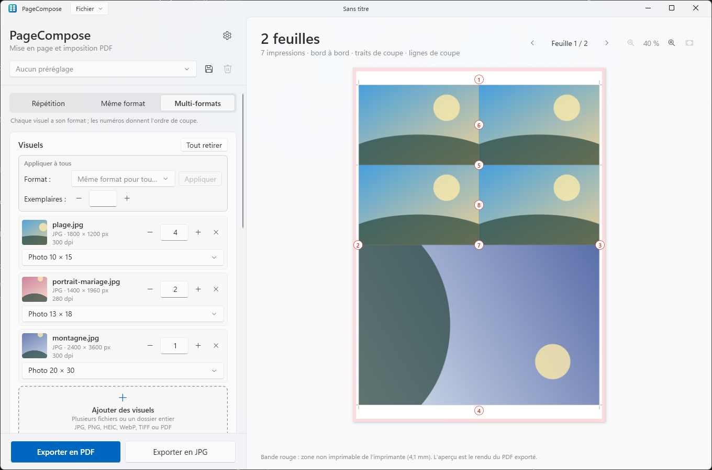
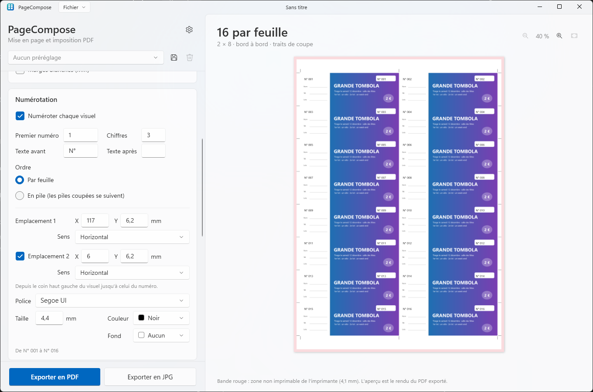

<p align="center">
  
</p>

<h1 align="center">PageCompose</h1>

<p align="center">
  Mettez en page cartes de visite, tirages photo et flyers sur une feuille, prêts à imprimer, en quelques clics.
</p>

<p align="center">
  <a href="README.md">English</a> · <b>Français</b>
</p>

<p align="center">
  
</p>

---

## Fonctionnalités

PageCompose transforme vos photos et PDF en **PDF prêt à imprimer** : autant d'exemplaires que la feuille en contient,
avec traits de coupe et fond perdu, prêt pour le massicot. Pensé pour la FUJIFILM ApeosPro C810 for Photo (SRA3, A3,
A4), il convient à toute imprimante qui imprime en taille réelle.

### Trois modes

- **Répétition** : un seul visuel sur toute la feuille (cartes de visite, flyers).
- **Même format** : plusieurs visuels d'un même format, chacun avec son nombre d'exemplaires (les photos d'une
  commande).
- **Multi-formats** : plusieurs formats sur le moins de feuilles possible, les coupes numérotées dans l'ordre, et un
  plan de coupe à imprimer pour le massicot. Un même format ou un même nombre d'exemplaires pour toutes les photos.

### Formats et feuilles

- Cartes de visite, photos d'identité, tickets de tombola, tirages photo (du 9 × 13 au 20 × 30), cadres Polaroid et
  Instax, cartes pliées, cartes postales, flyers, ou une taille libre.
- SRA3, A3 et A4, tirages labo (10 × 15, 20 × 30, 30 × 45, sans marge) ou une feuille personnalisée.
- Un texte dans la bande blanche des cadres Polaroid et Instax : un prénom, une date.

### Mise en page

- Le montage qui place le plus de visuels, trouvé tout seul ; les photos pivotent quand elles tiennent mieux.
- Fond perdu, traits de coupe, lignes de coupe, espace entre les visuels, marges blanches.
- Recto verso : un verso commun, ou un par visuel, chacun retombe derrière son recto.
- Faites glisser une photo dans l'aperçu pour choisir la partie gardée ; un clic droit la fait pivoter, tenir
  entière ou zoomer dedans.
- **Numérotation** : un numéro sur chaque visuel (tickets de tombola, cartes numérotées), à un ou deux emplacements,
  chacun dans son sens, avec un fond si besoin ; par feuille, ou en pile pour que les piles coupées sortent dans l'ordre.
- Résolution et recadrage contrôlés pour chaque photo.

### Fichiers

- JPG, PNG, PDF, et photos d'iPhone (HEIC), WebP et TIFF.
- Glisser-déposer de fichiers ou d'un dossier entier.
- Photos intégrées telles quelles, sans recompression (sauf converties, ci-dessous) ; PDF de graphiste calés sur leur
  zone de coupe.
- Converties en sRGB à l'import : les HEIC, WebP et TIFF, et les photos en Adobe RGB, Display P3… pour des couleurs
  justes (une option des paramètres).

### Export

- PDF, PDF aplati ou JPG en 300 dpi, avec un aperçu fidèle : ce que vous voyez est le PDF (dessiné avec des copies
  allégées des photos, pour la vitesse ; les exports prennent toujours les originaux).
- Un repère sur chaque feuille (nom, date, feuille 2/5) pour les trier au massicot.
- **Projets** : les fichiers et réglages d'une commande dans un seul fichier, enregistré comme un document (menu
  Fichier, Ctrl+S), pour la réimprimer plus tard ; les récents dans le menu Fichier, avec leur première feuille. Le
  dernier travail, même jamais enregistré, y est gardé aussi, et peut revenir au démarrage (un réglage, désactivé par
  défaut).
- **Préréglages** : vos réglages habituels en un clic.

### Et aussi

Annuler et rétablir (Ctrl+Z, Ctrl+Y), un nombre changé en glissant son étiquette sur le côté, anglais et français,
thème clair ou sombre, mises à jour en un clic.

Exemples sur une feuille SRA3 :

| Format | Bord à bord | Avec fond perdu 2 mm |
|--------|:---:|:---:|
| Carte de visite 85 × 55 | 25 | 21 |
| Photo d'identité 35 × 45 | 72 | 66 |
| Ticket de tombola 150 × 50 | 16 | 10 |
| Photo 10 × 15 | 8 | 4 |
| Photo 9 × 13 | 9 | 9 |
| Photo 13 × 18 | 4 | 4 |
| Polaroid classique 88 × 107 | 12 | 9 |
| Instax Mini 54 × 86 | 25 | 21 |
| Carte postale A6 | 8 | 6 |

<p align="center">
  
</p>

En mode Multi-formats, une commande de quatre 10 × 15, deux 13 × 18 et un 20 × 30 tient sur 2 feuilles SRA3, là où une
planche par format en prend 3 :

<p align="center">
  
</p>

Des tickets de tombola numérotés sur le ticket et sur sa souche :

<p align="center">
  
</p>

### Imprimer le PDF

Le PDF fait exactement la taille de la feuille et contient déjà la mise en page : imprimez-le **en taille réelle
(100 %)**, sans mise à l'échelle ni imposition de la part du pilote ou du serveur d'impression. Avec un FUJIFILM
GP Controller, déposez-le dans un hot folder réglé en taille réelle et sans imposition. Une feuille de tirage labo
part au labo à sa taille, sans marge.

## Installation

1. Téléchargez `PageCompose-Setup-x.y.z.exe` depuis la page [Releases](../../releases).
2. Lancez-le. L'installateur n'étant pas signé, Windows SmartScreen peut afficher « Windows a protégé votre
   ordinateur » : cliquez sur **Informations complémentaires → Exécuter quand même**.
3. Acceptez la demande d'administrateur (UAC).

L'installateur :

- copie l'application dans `C:\Program Files\PageCompose` et l'ajoute au menu Démarrer (raccourci bureau en option) ;
- associe les fichiers de préréglages `.PageComposePreset` et les projets `.PageComposeProject` à PageCompose (leurs
  icônes, et le double clic qui les importe ou les ouvre) ;
- propose d'installer le **.NET 10 Desktop Runtime** de Microsoft s'il manque.

Les versions suivantes s'installent depuis l'application : quand l'une d'elles est disponible, une barre propose de
**Mettre à jour** (ou passez par **Paramètres → Mises à jour**). Le nouvel installateur est téléchargé depuis GitHub,
contrôlé avec le SHA-256 publié par GitHub, installé sans fenêtre d'assistant, puis PageCompose redémarre.

Pour désinstaller : **Paramètres → Applications → Applications installées → PageCompose**. Le désinstalleur retire
l'application, ses fichiers temporaires et ses associations de fichiers, et demande s'il faut aussi supprimer vos réglages et préréglages (Non par
défaut, pour les retrouver après une réinstallation).

**Configuration requise :** Windows 10 2004 ou plus récent, x64 (conçu pour Windows 11).

## Développement

### Prérequis

Tout s'installe avec `winget` (intégré à Windows 11), depuis un terminal :

| Outil | Rôle | Installation |
|-------|------|--------------|
| **Git** | Récupérer le code | `winget install Git.Git` |
| **SDK .NET 10** | Compiler l'application (C# / WPF) et lancer les tests | `winget install Microsoft.DotNet.SDK.10` |
| **Inno Setup 6** | Construire l'installateur | `winget install JRSoftware.InnoSetup` |

N'importe quel éditeur (Visual Studio, VS Code, Rider) convient pour le code C#.

### Compiler

```powershell
.\scripts\build.ps1
```

Le script lance les tests, puis produit dans `dist\` :

| Fichier | Contenu |
|---------|---------|
| `app\` | l'application (`PageCompose.exe`…), dépendante du runtime .NET |
| `PageCompose-Setup-<version>.exe` | l'installateur |

Options : `-SkipTests`, `-NoInstaller`.

### Pendant le développement

```powershell
dotnet test tests\PageCompose.Core.Tests                            # tests unitaires
dotnet run --project src\PageCompose.App -- "C:\chemin\vers\photos" # lancer l'appli avec des fichiers ou un dossier
```

Définissez la variable d'environnement `PAGECOMPOSE_LANG` à `en` ou `fr` avant de lancer l'application pour vérifier
l'autre langue sans changer de réglage, et `PAGECOMPOSE_THEME` à `Light` ou `Dark` pour l'autre thème.

### Organisation du code

```
src/
  PageCompose.Core/   Logique sans interface : calcul du montage, placement des formats mélangés (coupes
                      au massicot), placement, répartition sur les feuilles, lecture des visuels (taille,
                      EXIF, TrimBox PDF), écriture du PDF (PDFsharp), liste des versions publiées sur
                      GitHub (mises à jour)
  PageCompose.App/    Application WPF : panneau de réglages, aperçu (Windows.Data.Pdf), glisser-déposer,
                      conversion HEIC / WebP / TIFF, projets, annulation, paramètres, mises à jour, textes
                      de l'interface
installer/            Script Inno Setup de l'installateur
scripts/              build.ps1 (compilation complète), make-icons.ps1 (régénère les icônes)
tests/                Tests unitaires (xUnit)
docs/                 Icône du README, icônes en SVG (docs/icons)
.github/workflows/    Compilation automatique sur GitHub (et publication des versions)
```

### Traductions

| Quoi | Où |
|------|----|
| Textes de l'application | `src/PageCompose.App/Properties/Strings.resx` (anglais, par défaut) et `Strings.fr.resx` (français). Les tests vérifient que les deux ont les mêmes clés et les mêmes `{0}`, et que chaque clé utilisée par le code existe. |
| Messages de l'installateur | `[Languages]` et `[CustomMessages]` dans `installer/PageCompose.iss` |
| Langues proposées dans les Paramètres | `AppSettings.SupportedLanguages` dans `src/PageCompose.App/Services/AppSettings.cs` |

Ajouter une langue, c'est mettre à jour ces trois endroits, plus un `README.<langue>.md` si vous le souhaitez.

### Icônes

`scripts\make-icons.ps1` dessine l'icône (`src/PageCompose.App/Assets/PageCompose.ico`, son image 256 px pour
l'application et `docs/icon-256.png`), celles des fichiers de préréglages et des projets
(`src/PageCompose.App/Assets/PresetFile.ico`, `ProjectFile.ico`, installées à côté de l'application) et leurs copies en
SVG (`docs/icons/PageCompose.svg`, `PresetFile.svg`, `ProjectFile.svg`), pour retravailler les dessins dans un éditeur vectoriel ; les petites tailles des `.ico` sont calées au pixel par le
script. Les fichiers générés sont versionnés : ne relancez le script que pour changer le dessin.

### Publier une version

1. Mettez à jour `<Version>` dans `Directory.Build.props`.
2. Commitez, puis créez et poussez un tag : `git tag v1.0.0`, puis `git push origin v1.0.0`.
3. Le workflow GitHub Actions compile, teste et publie l'installateur dans une Release.

Un tag avec suffixe (`v1.1.0-beta.1`) est publié comme *pre-release* : seules les applications réglées sur le canal
**Bêta** le proposent. Les applications installées trouvent la nouvelle version à leur prochain lancement.

## Feuille de route

- [x] Plusieurs formats sur la même feuille (mode Multi-formats, 0.5.0).
- [ ] **Signature gratuite** de l'installateur via [SignPath Foundation](https://signpath.org) (projets open source) :
  plus d'avertissement SmartScreen.

## Politique de confidentialité

Vos visuels et vos PDF ne quittent jamais votre ordinateur.

Le seul accès réseau est la **recherche de mises à jour** : au lancement (si *Rechercher les mises à jour au démarrage*
est activé, ce qui est le cas par défaut) et quand vous cliquez sur *Rechercher des mises à jour*, l'application
envoie une requête HTTPS à l'API de GitHub (`api.github.com`) pour lire la liste des versions de PageCompose. Aucun
fichier, visuel ou donnée personnelle n'est envoyé ; comme pour toute requête web, GitHub voit votre adresse IP, et la
version de l'application dans le User-Agent. Quand vous acceptez une mise à jour, son installateur est téléchargé
depuis GitHub. Désactivez la vérification au démarrage dans **Paramètres → Mises à jour** : l'application ne fait
alors aucune requête sans que vous la demandiez.

Les liens des Paramètres (*QuentinPerou*, *Code source sur GitHub*, *Nouveautés*) ne s'ouvrent dans votre navigateur
que si vous cliquez dessus.

## Licence

[MIT](LICENSE.md). Utilise [PDFsharp](https://github.com/empira/PDFsharp) (MIT).

## Crédits

Développé par [QuentinPerou](https://github.com/quentinperou), avec [Claude Code](https://claude.com/claude-code) (Anthropic).
