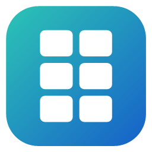
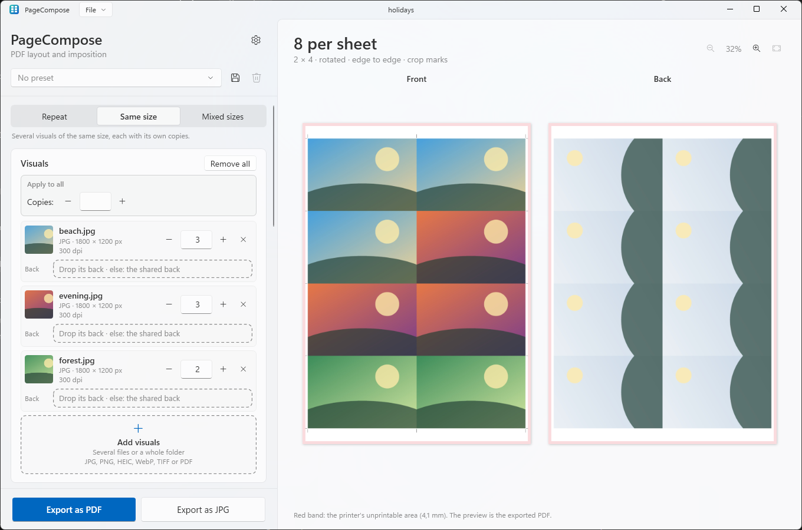
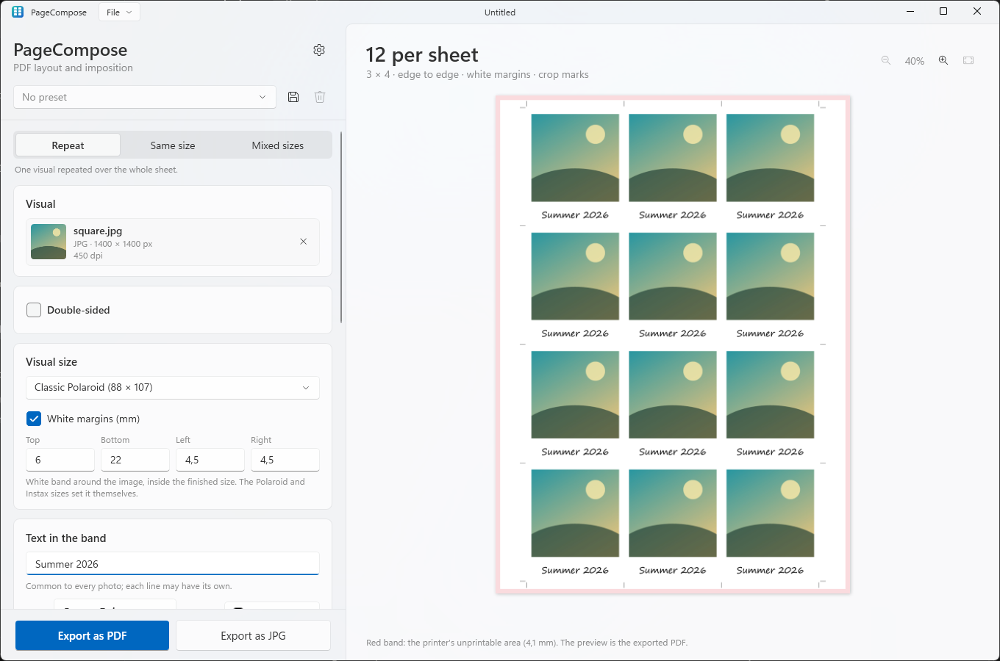
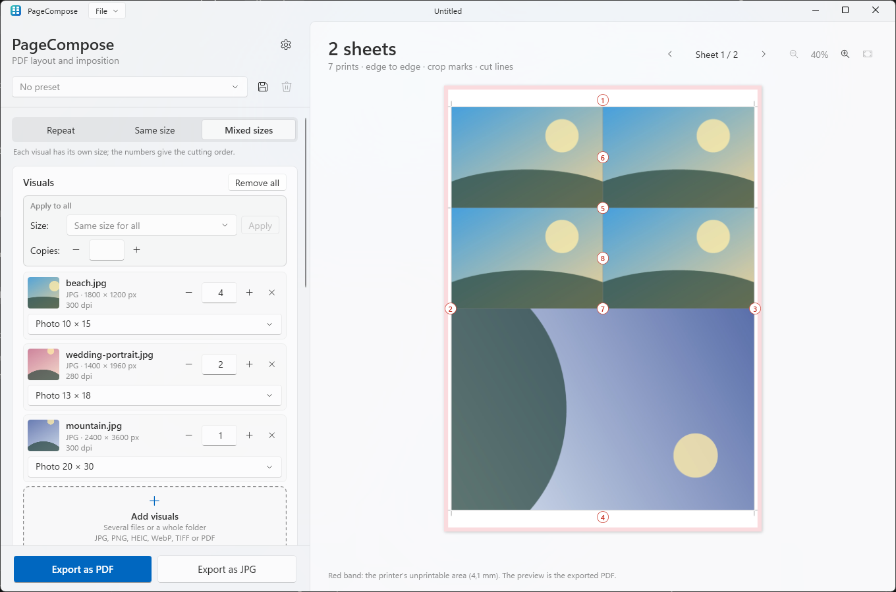
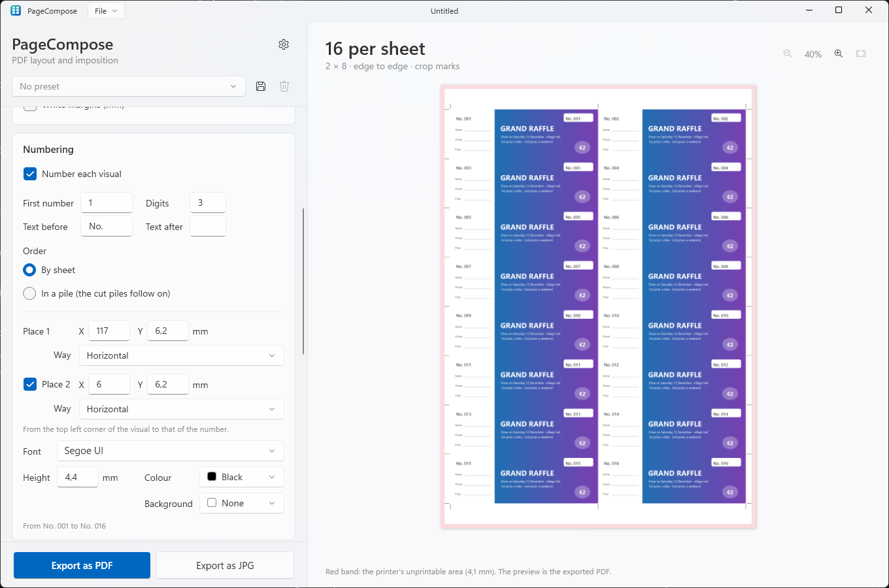

<p align="center">
  
</p>

<h1 align="center">PageCompose</h1>

<p align="center">
  Lay out business cards, photo prints and flyers on a sheet, ready to print, in a few clicks.
</p>

<p align="center">
  <b>English</b> · <a href="README.fr.md">Français</a>
</p>

<p align="center">
  
</p>

---

## Features

PageCompose turns your photos and PDFs into a **print-ready PDF**: as many copies as fit on the sheet, with crop marks
and bleed, ready for the guillotine. Made for the FUJIFILM ApeosPro C810 for Photo (SRA3, A3, A4), it works with any
printer that prints at actual size.

### Three modes

- **Repeat**: one visual over the whole sheet (business cards, flyers).
- **Same size**: several visuals of one size, each with its own number of copies (the photos of an order).
- **Mixed sizes**: several sizes on as few sheets as possible, the cuts numbered in order, and a cutting plan to print
  for the guillotine. One size or one number of copies for every photo at once.

### Sizes and sheets

- Business cards, ID photos, raffle tickets, photo prints (9 × 13 to 20 × 30), Polaroid and Instax frames, folded
  cards, postcards, flyers, or any size you type.
- SRA3, A3 and A4, lab prints (10 × 15, 20 × 30, 30 × 45, borderless) or a custom sheet.
- A text in the white band of the Polaroid and Instax frames: a name, a date.

### Layout

- The layout that holds the most visuals, found automatically; photos turn when they fit better.
- Bleed, crop marks, cut lines, space between visuals, white margins.
- Double-sided: one back for all, or one per visual, each landing behind its front.
- Drag a photo on the preview to choose the part kept; a right click turns it, fits it whole or zooms into it.
- **Numbering**: a number on each visual (raffle tickets, numbered cards), at one or two places, each its own way, with
  a background if needed; by sheet, or in a pile so that the cut piles come out in order.
- Resolution and cropping checked for each photo.

### Files

- JPG, PNG, PDF, and iPhone photos (HEIC), WebP and TIFF.
- Drag and drop files or a whole folder.
- Photos embedded as they are, without recompression (unless converted, below); designer PDFs placed on their trim box.
- Converted to sRGB when added: HEIC, WebP and TIFF, and photos in Adobe RGB, Display P3… for true colours (an option
  of the settings).

### Export

- PDF, flattened PDF or JPG at 300 dpi, with a true preview: what you see is the PDF (drawn with lighter copies of
  the photos, for speed; the exports always take the originals).
- A mark on each sheet (name, date, sheet 2/5) to sort them at the guillotine.
- **Projects**: the files and settings of an order in one file, saved like a document (File menu, Ctrl+S), to print it
  again later; the recent ones in the File menu, with their first sheet. The last job, even never saved, is kept there
  too, and can come back at start (a setting, off by default).
- **Presets**: your usual settings in one click.

### And also

Undo and redo (Ctrl+Z, Ctrl+Y), a number changed by dragging its label sideways, English and French, light or dark
theme, updates in one click.

Examples on an SRA3 sheet:

| Size | Edge to edge | With 2 mm bleed |
|------|:---:|:---:|
| Business card 85 × 55 | 25 | 21 |
| ID photo 35 × 45 | 72 | 66 |
| Raffle ticket 150 × 50 | 16 | 10 |
| Photo 10 × 15 | 8 | 4 |
| Photo 9 × 13 | 9 | 9 |
| Photo 13 × 18 | 4 | 4 |
| Classic Polaroid 88 × 107 | 12 | 9 |
| Instax Mini 54 × 86 | 25 | 21 |
| A6 postcard | 8 | 6 |

<p align="center">
  
</p>

In Mixed sizes mode, an order of four 10 × 15, two 13 × 18 and one 20 × 30 takes 2 SRA3 sheets, where one sheet per size
takes 3:

<p align="center">
  
</p>

Raffle tickets numbered on the ticket and on its stub:

<p align="center">
  
</p>

### Printing the PDF

The PDF is exactly the size of the sheet and already holds the layout: print it at **actual size (100 %)**, without
any scaling or imposition from the printer driver or the print server. With a FUJIFILM GP Controller, drop it in a
hot folder set to the real size and no imposition. A lab print sheet goes to the lab at its size, borderless.

## Installation

1. Download `PageCompose-Setup-x.y.z.exe` from the [Releases](../../releases) page.
2. Run it. As the installer is not signed, Windows SmartScreen may show “Windows protected your PC”:
   click **More info → Run anyway**.
3. Accept the administrator prompt (UAC).

The installer:

- copies the app to `C:\Program Files\PageCompose` and adds it to the Start menu (desktop shortcut optional);
- associates the `.PageComposePreset` preset files and the `.PageComposeProject` projects with PageCompose (their icons, and
  the double click that imports or opens them);
- offers to install the Microsoft **.NET 10 Desktop Runtime** if it is missing.

Later versions install from the app: when one is available, a bar offers to **Update** (or use **Settings →
Updates**). The new installer is downloaded from GitHub, checked against the SHA-256 published by GitHub, installed
silently, and PageCompose starts again.

To uninstall: **Settings → Apps → Installed apps → PageCompose**. The uninstaller removes the app, its temporary
files and its file associations, and asks whether to delete your settings and presets too (No by default, to find them again after a
reinstall).

**Requirements:** Windows 10 2004 or later, x64 (made for Windows 11).

## Development

### Prerequisites

Everything installs with `winget` (built into Windows 11), from a terminal:

| Tool | Purpose | Install |
|------|---------|---------|
| **Git** | Get the code | `winget install Git.Git` |
| **.NET 10 SDK** | Build the app (C# / WPF) and run the tests | `winget install Microsoft.DotNet.SDK.10` |
| **Inno Setup 6** | Build the installer | `winget install JRSoftware.InnoSetup` |

Any editor (Visual Studio, VS Code, Rider) is fine for the C# code.

### Build

```powershell
.\scripts\build.ps1
```

The script runs the tests, then produces in `dist\`:

| File | Content |
|------|---------|
| `app\` | the app (`PageCompose.exe`…), framework-dependent |
| `PageCompose-Setup-<version>.exe` | the installer |

Options: `-SkipTests`, `-NoInstaller`.

### While developing

```powershell
dotnet test tests\PageCompose.Core.Tests                            # unit tests
dotnet run --project src\PageCompose.App -- "C:\path\to\photos"     # run the app with files or a folder
```

Set the `PAGECOMPOSE_LANG` environment variable to `en` or `fr` before starting the app to check the other
language without changing any setting, and `PAGECOMPOSE_THEME` to `Light` or `Dark` for the other theme.

### Code layout

```
src/
  PageCompose.Core/   Logic without UI: layout computation, packing of mixed sizes (guillotine cuts),
                      placement, distribution over the sheets, reading the visuals (size, EXIF, PDF
                      TrimBox), writing the PDF (PDFsharp), list of the GitHub releases (updates)
  PageCompose.App/    WPF app: settings panel, preview (Windows.Data.Pdf), drag and drop, HEIC / WebP / TIFF
                      conversion, projects, undo, settings, updates, UI strings
installer/            Inno Setup script of the installer
scripts/              build.ps1 (full build), make-icons.ps1 (regenerates the icons)
tests/                Unit tests (xUnit)
docs/                 README icon, SVG icons (docs/icons)
.github/workflows/    Automated build on GitHub (and release publishing)
```

### Translations

| What | Where |
|------|-------|
| App texts | `src/PageCompose.App/Properties/Strings.resx` (English, the default) and `Strings.fr.resx` (French). The tests check that both have the same keys and placeholders, and that every key used by the code exists. |
| Installer messages | `[Languages]` and `[CustomMessages]` in `installer/PageCompose.iss` |
| Languages offered in Settings | `AppSettings.SupportedLanguages` in `src/PageCompose.App/Services/AppSettings.cs` |

Adding a language means updating these three places, plus a `README.<language>.md` if you like.

### Icons

`scripts\make-icons.ps1` draws the icon (`src/PageCompose.App/Assets/PageCompose.ico`, its 256 px image for the app,
and `docs/icon-256.png`), the icons of the preset files and of the projects
(`src/PageCompose.App/Assets/PresetFile.ico`, `ProjectFile.ico`, installed next to the app) and SVG copies of them
(`docs/icons/PageCompose.svg`, `PresetFile.svg`, `ProjectFile.svg`) to rework the designs in a vector editor; the small sizes of the `.ico` files are fitted to whole pixels by the script. The generated files are
committed: run it again only to change the design.

### Releasing a version

1. Update `<Version>` in `Directory.Build.props`.
2. Commit, then create and push a tag: `git tag v1.0.0`, then `git push origin v1.0.0`.
3. The GitHub Actions workflow builds, tests and publishes the installer in a Release.

A tag with a suffix (`v1.1.0-beta.1`) is published as a *pre-release*: only the apps set to the **Beta** update channel
offer it. Installed apps find a new version at their next start.

## Roadmap

- [x] Several sizes on the same sheet (Mixed sizes mode, 0.5.0).
- [ ] **Free signing** of the installer through [SignPath Foundation](https://signpath.org) (for open source projects): no more SmartScreen warning.

## Privacy policy

Your visuals and PDF files never leave your computer.

The only network access is the **update check**: when the app starts (if *Check for updates at startup* is on, the
default) and when you click *Check for updates*, it sends one HTTPS request to the GitHub API (`api.github.com`) to
read the list of PageCompose releases. No file, visual or personal data is sent; like any web request, GitHub sees
your IP address, and the app version in the User-Agent. When you accept an update, its installer is downloaded from
GitHub. Turn off the check at startup in **Settings → Updates** and the app makes no request unless you ask for one.

The links in Settings (*QuentinPerou*, *Source code on GitHub*, *What's new*) open in your browser only when you
click them.

## License

[MIT](LICENSE.md). Uses [PDFsharp](https://github.com/empira/PDFsharp) (MIT).

## Credits

Developed by [QuentinPerou](https://github.com/quentinperou), with [Claude Code](https://claude.com/claude-code) (Anthropic).
